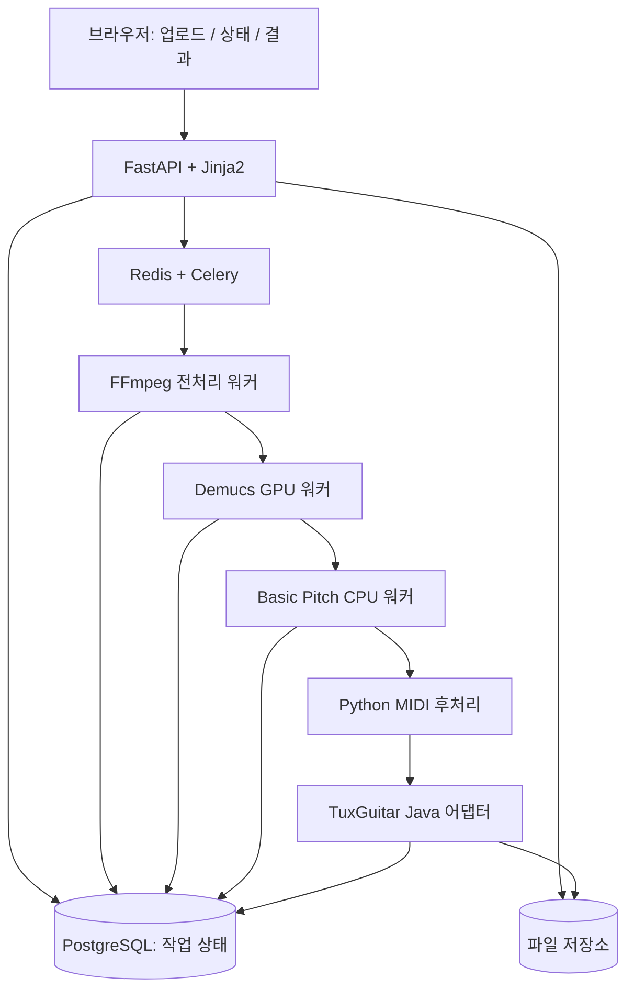

# Music to Tab — Python 웹서비스 설계

이 문서는 구현 설계이며 실행 가능한 서비스나 변환 정확도를 검증한 결과가 아니다.

## 1. 목표와 첫 버전 범위

사용자가 음원을 업로드하면 기타 STEM, MIDI, 편집 가능한 TAB 파일을 제공한다.
첫 버전은 6현 기타, 표준 튜닝(E2 A2 D3 G3 B3 E4), 최대 24프렛을 기본으로 한다.
튜닝·카포·BPM·박자표는 사용자 입력으로 변경할 수 있게 한다.
업로드 한도는 초기 정책으로 100MB/5분을 제안하며 실제 서버 성능 측정 후 조정한다.
여러 기타가 함께 녹음된 경우 Demucs의 guitar STEM에 함께 남을 수 있다.
리드/리듬 기타를 개별 연주자로 분리하거나 벤딩·슬라이드 주법을 정확히 복원하는 것은 첫 버전 보장 범위에서 제외한다.

## 2. 구성



웹 화면은 Python의 Jinja2 템플릿과 소량의 JavaScript로 구현한다. 별도 React 앱은 필수가 아니다.
상태 조회는 초기에는 2~3초 간격 polling으로 충분하다.
API 요청은 업로드·작업 등록만 수행하고 즉시 202를 반환한다. 모델 실행을 FastAPI BackgroundTasks에 맡기지 않는다.

| 역할 | 기술 | 설계 이유 |
| --- | --- | --- |
| API / HTML | FastAPI, Pydantic, Jinja2 | Python 중심의 입력 검증과 웹 화면 |
| 작업 상태 | SQLAlchemy, Alembic, PostgreSQL | 재시작 후에도 작업/소유권/결과 유지 |
| 실행 대기열 | Celery, Redis | 긴 변환 작업 분리 및 자원별 실행 제한 |
| 오디오 준비 | FFmpeg, ffprobe | 디코딩, 길이 검사, WAV 준비 |
| 기타 추출 | Demucs htdemucs_6s | guitar 출력이 있는 6-STEM 모델 |
| MIDI 추정 | Basic Pitch | 분리된 기타 오디오를 음표로 변환 |
| MIDI 후처리 | pretty_midi 또는 mido | 음표 정리 및 시간축 변환 |
| TAB 변환 | TuxGuitar + 자체 Java 어댑터 | Python에서 외부 변환 프로세스 호출 |
| 파일 | 개발: 로컬 볼륨 / 운영: S3 호환 저장소 | 작업별 입력·중간·출력 파일 분리 |

Linux 컨테이너 배포를 기준으로 한다. Windows 개발 환경에서는 Docker/WSL2를 사용할 수 있다.
모델 워커의 Python은 3.10을 초기 호환성 검증 대상으로 삼는다. 정확한 패키지·모델 버전은 통합 실행 후 lock 파일과 이미지 digest로 고정한다.
Demucs와 Basic Pitch는 서로 다른 이미지로 분리해 PyTorch와 추론 런타임의 의존성 충돌을 줄인다.
GPU 워커는 초기 GPU당 동시 작업 1개, Basic Pitch는 우선 CPU로 설정하고 측정 후 조정한다.

## 3. 변환 단계

1. 업로드를 스트리밍으로 저장하면서 바이트 제한을 적용한다. 원래 파일명을 경로로 사용하지 않는다.
2. ffprobe/실제 디코딩으로 오디오 존재·길이·채널을 확인한다. 확장자나 MIME만으로 허용하지 않는다.
3. 원본을 보관하고 Demucs용 stereo WAV를 준비한다. 모델 입력 사양에 맞는 샘플레이트를 사용한다.
4. Demucs의 `htdemucs_6s`로 분리한 `guitar.wav`를 저장한다. 기본 4-STEM 모델로 대체하지 않는다.
5. Basic Pitch에서 기타 WAV를 분석해 `raw.mid`와 음표 이벤트를 저장한다. 필요한 리샘플링은 해당 라이브러리 입력 처리 규칙을 따른다.
6. 원본 MIDI를 유지하면서 별도 `clean.mid`를 만든다. 짧은 노이즈 음표·중복·음역을 설정에 따라 정리한다.
7. BPM, 박자표, 첫 박 위치를 이용해 시작과 끝을 박 단위로 변환한다. 초기에는 고정 BPM과 사용자 보정을 사용한다. 가변 템포와 셋잇단음표는 후속 범위로 둔다.
8. 양자화 후 길이가 0이 되지 않게 보정하고, 마디를 넘는 음표는 타이로 표현한다. 모든 겹침을 무조건 제거하지 않는다.
9. TuxGuitar 어댑터가 정리한 MIDI를 읽어 기타 트랙으로 변환하고 줄·프렛 배치를 수행한 뒤 편집 가능한 파일을 내보낸다.
10. 출력 파일을 다시 열어 음표 수·음높이·박자·줄/프렛 범위를 확인한 다음 결과로 공개한다.

무음 또는 추정 음표가 없는 경우 빈 악보를 성공 결과로 내보내지 않고 `NO_NOTES_DETECTED`를 반환한다.
음역 밖 음표와 연주 불가능한 겹침은 자동 삭제 대신 경고로 기록하고 보정 선택지를 제공한다.
Basic Pitch의 pitch bend 정보를 원본 MIDI에 보존하되, TAB 주법으로 정확히 변환했다고 표시하지 않는다.

## 4. TuxGuitar 연동 경계 — 우선 검증할 부분

TuxGuitar는 Python 패키지가 아니므로 전체 서비스를 순수 Python만으로 구성할 수는 없다.
웹/API/작업 제어는 Python이 담당하고 TuxGuitar는 Java 프로세스로 격리한다.
공식 저장소에서 확인한 정보만으로 범용 headless 변환 CLI가 있다고 가정하지 않는다.

권장 PoC는 특정 TuxGuitar 버전의 MIDI importer, 기타 줄 배치 로직, 파일 writer를 호출하는 작은 Java 어댑터다.
이 방식의 GUI 의존성, 플러그인 초기화, headless 실행 가능 여부를 먼저 검증해야 한다.
검증에 실패하면 GUI 자동화를 운영 파이프라인에 바로 넣지 말고 어댑터 구현 범위와 배포 방식을 재검토한다.

다음은 **직접 구현할 어댑터 계약**이며 TuxGuitar에 이미 존재하는 명령어가 아니다.

```text
java -jar tab-adapter.jar --request request.json --result result.json
```

request.json은 입력 MIDI 절대 경로, 출력 디렉터리, 튜닝(MIDI 번호), 카포, 최대 프렛, BPM, 박자표를 받는다.
튜닝 배열은 낮은 줄부터 `[40, 45, 50, 55, 59, 64]`로 고정하고 줄 번호는 6번이 가장 낮은 줄임을 계약에 명시한다.
카포 사용 시 `실제 음높이 = 개방현 MIDI + 카포 + 카포 기준 프렛`으로 정의한다.
result.json은 생성 파일, 경고, 음표 수, 변환기 버전, 오류 코드를 반환한다.
서버가 출력 경로가 해당 작업 디렉터리 안에 있는지 검증한 뒤 저장소에 등록한다.

먼저 편집용 `.tg` 출력을 검증한다. PDF, MusicXML, GP 파일 및 브라우저 렌더링용 데이터는 해당 버전의 실제 export 가능 여부를 검증한 뒤 활성화한다.
PDF exporter가 검증되면 브라우저 PDF 뷰어로 초기 미리보기를 제공할 수 있다. 검증 전에는 PDF 다운로드를 UI에 노출하지 않는다.

줄 배치 검증 기준:

- 모든 음표의 음높이가 배치한 줄·프렛의 실제 음높이와 일치할 것.
- 동시에 유지되는 서로 다른 음표가 같은 줄을 사용하지 않을 것.
- 튜닝, 카포, 프렛 범위를 지킬 것.
- 연속 음표의 위치 이동과 코드 내 프렛 간격을 평가할 것.
- 배치 불가를 명시적으로 반환할 것. 임의 옥타브 이동으로 숨기지 않을 것.

TuxGuitar의 기본 배치가 충분하지 않으면 Java 어댑터에서 후보 줄·프렛에 대한 비용 기반 탐색을 추가한다.
MIDI 자체에는 줄·프렛 정보가 없으므로 Python에서 배치 정보를 만들 경우 별도 JSON으로 전달해야 한다.

## 5. Python 모듈 구조

```text
music-to-tab/
  app/
    main.py
    api/jobs.py
    schemas/jobs.py
    db/models.py
    services/job_service.py
    services/storage.py
    templates/index.html
    templates/job.html
    static/app.js
  workers/
    celery_app.py
    tasks.py
    stages/preprocess.py
    stages/separate.py
    stages/transcribe.py
    stages/quantize.py
    stages/tablature.py
  contracts/
    tab-request.schema.json
    tab-result.schema.json
  tuxguitar_adapter/
    src/
  tests/
    fixtures/
    integration/
  migrations/
  docker/
  compose.yaml
```

각 stage는 저장소의 object key 또는 작업 ID를 받고 산출물 메타데이터를 반환한다.
대용량 파일·모델·NumPy 배열을 Redis 메시지에 넣지 않는다.
모델은 워커 시작 시 한 번 로드하고, 요청별 공유 상태가 섞이지 않게 한다.

Python 경계의 예시(구현 계약):

```python
from dataclasses import dataclass
from pathlib import Path
from typing import Protocol

@dataclass(frozen=True)
class TabOptions:
    bpm: float
    numerator: int = 4
    denominator: int = 4
    tuning: tuple[int, ...] = (40, 45, 50, 55, 59, 64)
    capo: int = 0
    max_fret: int = 24

@dataclass(frozen=True)
class TabResult:
    editable_file: Path
    preview_file: Path | None
    warnings: tuple[str, ...]

class TabConverter(Protocol):
    def convert(
        self, midi: Path, output_dir: Path, options: TabOptions
    ) -> TabResult: ...
```

실제 구현에서 `subprocess.run([...], shell=False, check=True, timeout=...)`와 신뢰된 실행 파일 경로를 사용한다.
사용자 입력을 명령 문자열에 삽입하지 않는다. 타임아웃/취소 시 하위 프로세스까지 종료하는 관리 계층을 둔다.

## 6. HTTP API

| 메서드 | 경로 | 동작 |
| --- | --- | --- |
| POST | /api/jobs | multipart 음원 + 옵션 제출, 202와 job_id/status_url 반환 |
| GET | /api/jobs/{id} | 상태, 현재 단계, 경고, 사용 가능한 산출물 반환 |
| GET | /api/jobs/{id}/artifacts/{artifact_id} | 소유권 확인 후 다운로드 |
| POST | /api/jobs/{id}/cancel | 취소 요청, 202; 실제 중단 후 cancelled 처리 |
| DELETE | /api/jobs/{id} | 실행 중이면 먼저 취소하고 파일·메타데이터 정리 |

작업 상태와 단계를 분리한다.

```text
status: queued | running | cancel_requested | cancelled | succeeded | failed
stage: validating | preprocessing | separating | transcribing | quantizing | rendering
```

모델이 실제 진행률을 제공하지 않으면 가짜 백분율 대신 현재 단계와 대기 상태를 표시한다.
POST에는 Idempotency-Key를 지원하고 같은 사용자·키·입력 해시에 대해 기존 작업을 반환한다.
등록 한도 초과는 413, 잘못된 옵션은 422, 과도한 요청은 429를 사용한다.
비동기 처리 중 발견한 오류는 작업의 error_code로 반환하고 서버 경로·스택 추적은 공개하지 않는다.

## 7. 상태 및 파일 저장

- jobs: id, owner_id, status, stage, options_json, error_code, warnings_json, created_at, updated_at, expires_at, cancel_requested_at.
- job_attempts: job_id, stage, attempt, lease_token, heartbeat_at, started_at, finished_at, model_version, input_hash.
- artifacts: id, job_id, kind, object_key, size_bytes, sha256, created_at.
- outbox: DB 작업 등록과 대기열 발행 사이의 유실을 막는 발행 대기 레코드.

파일 키는 `jobs/{job_id}/input/source`, `guitar.wav`, `raw.mid`, `clean.mid`, `score.tg` 형태로 서버가 생성한다.
사용자 파일명은 표시용 메타데이터로만 저장한다. 운영 저장소는 비공개로 두고 다운로드 때 소유권을 확인한다.

Celery 메시지는 재전달될 수 있으므로 각 단계는 입력 해시·버전으로 재사용 가능 여부를 판단하고, 임시 경로에 쓴 뒤 완료 산출물로 등록한다.
lease token으로 오래된 워커가 상태를 덮어쓰지 못하게 하며 취소/실패/완료 상태 전이를 조건부 갱신한다.
일시적인 저장소/네트워크 오류만 제한 재시도한다. 잘못된 음원이나 동일한 OOM은 무한 재시도하지 않는다.
heartbeat가 끊긴 작업은 복구 스케줄러가 재큐잉하거나 실패 처리한다.
파일 보관은 초기 24시간 정책을 제안한다. 만료 청소 작업은 실행 중인 작업을 건드리지 않고, 삭제가 확인될 때까지 재시도한다.

## 8. 배포 및 검증 순서

1. 알려진 음표·코드·마디 넘김을 포함한 작은 MIDI로 TuxGuitar headless 어댑터와 파일 재열기를 검증한다.
2. 짧은 기타 단독 녹음으로 Basic Pitch → 후처리 → TAB을 확인한다.
3. 짧은 전체 믹스 음원으로 Demucs를 포함한 전체 흐름을 확인한다.
4. FastAPI, DB, 대기열, 업로드 화면과 결과 다운로드를 연결한다.
5. 두 사용자 동시 실행, 중복 메시지, 워커 중단, 취소, 만료 정리, 권한 없는 다운로드를 검증한다.
6. 고정된 샘플 세트로 음표 precision/recall, onset 오차, 줄 배치 불가 비율, 처리 시간, 최대 RAM/VRAM을 측정한다.

첫 배포는 Linux 호스트에 API, PostgreSQL, Redis, CPU 워커, GPU 워커, Java 변환기를 분리한 구성을 사용한다.
일반 정적 웹 호스팅이나 Sites의 Worker 런타임만으로 모델 추론/Java 변환을 실행하는 구조는 사용하지 않는다.
이 설계 단계에서는 패키지 설치, 모델 다운로드, 서버 실행 또는 배포를 수행하지 않는다.

## 9. 근거 자료

- Demucs 공식 저장소: https://github.com/facebookresearch/demucs — htdemucs_6s와 기타 출력. Meta 저장소는 archived 상태이므로 버전과 모델 가중치를 고정해 재현성을 확보한다.
- Basic Pitch 공식 저장소: https://github.com/spotify/basic-pitch — Python API/CLI, 단일 악기 입력 권장, 환경 호환성.
- TuxGuitar 공식 저장소: https://github.com/helge17/tuxguitar — Java 기반 악보 편집기. 위 Java 어댑터는 신규 구현 제안이다.

문서 확인일: 2026-10-10. 위 호환성 정보는 실제 대상 이미지의 설치·변환 테스트로 확정해야 한다.
