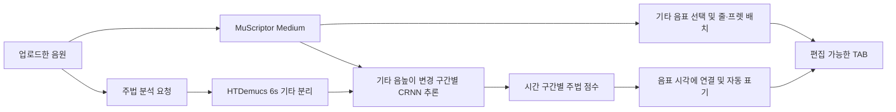

# Music to Tab

Music to Tab은 기타 녹음에서 **편집 가능한 기타 TAB**을 만드는 로컬 연구 프로토타입입니다. 음표를 채보하는 단계와 연주 주법을 추정하는 단계가 분리되어 있어, 먼저 TAB을 만든 뒤 필요할 때 주법을 분석할 수 있습니다.

현재 실행 위치는 `prototype/`이며, 웹 화면은 [http://127.0.0.1:4181/](http://127.0.0.1:4181/)에서 열립니다.

| 이용 방법 | 현재 상태 |
| --- | --- |
| **내 PC에서 실행** | [설치 및 실행 절차](#로컬에서-실행하기)에 따라 로컬 서버를 시작하고 브라우저에서 사용합니다. |
| **설치 없이 웹에서 사용** | 공개 분석 서버는 아직 제공하지 않습니다. [공개 및 배포 계획](DEPLOYMENT.md)에서 필요한 준비를 확인할 수 있습니다. |

## 할 수 있는 일

- **파일 채보:** MP3·WAV·M4A 파일을 받아 기타 음표를 표준 튜닝 6현 TAB으로 배치합니다. 파일당 최대 100 MiB, 5분입니다.
- **운지 정리:** 같은 음을 낼 수 있는 줄·프렛을 비교해 손의 이동과 코드 모양을 고려합니다. 기존 악보에는 **운지 정리** 버튼으로 적용할 수 있습니다.
- **주법 분석:** 기타 분리 음원에서 주법을 추정합니다. 음표별 최고 점수가 **70% 이상**이면 자동 표기하고, 낮은 점수의 후보도 직접 선택할 수 있도록 보존합니다.
- **연습과 편집:** 원본과 TAB 합성음의 재생 비율을 조절하고, 재생 속도를 바꾸거나 음표·운지·주법을 수정할 수 있습니다.
- **내보내기:** 현재 악보를 MIDI·JSON으로 저장하거나 인쇄 화면에서 PDF로 저장할 수 있습니다. MIDI에는 편집한 음높이와 타이밍이 반영되며 주법 기호는 포함되지 않습니다.
- **작업 저장:** 프로젝트는 브라우저 저장소에, 원본 음원은 IndexedDB에 저장됩니다. 한국어와 영어를 지원합니다.

## 처리 흐름



| 구성 | 역할 | 주소 |
| --- | --- | --- |
| Node.js 웹 서버 | 웹 화면 제공, 두 로컬 분석 서버에 요청 전달 | `127.0.0.1:4181` |
| MuScriptor 0.4.0 · Medium | 입력 음원을 악기별 음표와 MIDI로 변환 | `127.0.0.1:8222` |
| 주법 분석 서버 | HTDemucs 6s로 기타 분리 후 CRNN 실행 | `127.0.0.1:8224` |

MuScriptor가 만든 기타 MIDI는 **주법 모델의 오디오 입력이 아닙니다**. 주법 분석은 스테레오를 유지한 원본을 분리하고 `guitar` 스템만 사용합니다. 분리 결과는 로컬에 캐시되며, 분리 실패 시 원본 믹스를 대신 분석하지 않습니다. 채보는 원본 음원을 받는 별도 경로입니다.

## 로컬에서 실행하기

아래는 현재 검증에 사용한 Windows PowerShell 환경 기준입니다. Python 3.10, Node.js 24, Git, `uv`가 필요합니다. 검증 환경의 PyTorch는 `2.11.0+cu128`이며 NVIDIA GPU를 사용했습니다. GPU와 드라이버에 맞는 PyTorch 빌드를 선택하세요.

### 1. Python 환경 준비

저장소 루트에서 실행합니다.

```powershell
cd prototype
uv venv --python 3.10 .venv-muscriptor
$py = '.\.venv-muscriptor\Scripts\python.exe'
uv pip install --python $py --index https://download.pytorch.org/whl/cu128 torch==2.11.0 torchaudio==2.11.0 torchvision==0.26.0
uv pip install --python $py muscriptor==0.4.0 -r techniques/requirements.txt requests
```

[MuScriptor Medium 모델 페이지](https://huggingface.co/MuScriptor/muscriptor-medium)에서 접근 조건을 확인하고 접근 권한을 받은 뒤, `.\.venv-muscriptor\Scripts\hf.exe auth login`으로 로그인합니다. 토큰은 로컬 인증에만 사용합니다.

### 2. 주법 분석용 모델 준비

음표 채보만 사용한다면 이 단계와 주법 분석 서버는 생략할 수 있습니다. 주법 분석에는 공식 기타 분리 가중치와 이 프로젝트에서 학습한 CRNN 파일이 모두 필요합니다.

```powershell
& $py techniques/download_separator.py
```

공개본에 포함된 `techniques/tab-pitch-data/expanded-technique/classifier.pt`를 사용합니다. 활성 모델 경로는 `techniques/active-backend.json`에 있습니다.

### 3. 서버 실행

`prototype/`에서 각 명령을 별도 터미널에 실행합니다. 현재 웹 화면은 `dist/`를 그대로 제공하므로 별도의 프런트엔드 빌드가 필요하지 않습니다.

```powershell
# 음표 채보 서버
.\.venv-muscriptor\Scripts\muscriptor.exe serve --model medium --device cuda --port 8222

# 주법 분석 서버
.\.venv-muscriptor\Scripts\python.exe techniques/server.py

# 웹 서버
node muscriptor-server.cjs
```

[로컬 웹 화면](http://127.0.0.1:4181/)에서 파일을 업로드하고 채보한 뒤, 필요하면 **주법 분석**을 실행합니다. 첫 분석에는 기타 분리 시간이 추가됩니다. 혼자 연주한 기타 녹음은 업로드 시 **기타 단독**을 선택하면 MuScriptor에 기타 악기 조건이 전달됩니다. **악기 직접 선택**에서는 기타 종류와 함께 베이스, 드럼 등 구성 악기를 골라 채보 범위를 지정할 수 있습니다.

## 현재 한계

- 채보와 운지는 추정 결과입니다. 누락된 음과 연주하기 어려운 운지가 생길 수 있습니다. 마디는 선택한 박자표와 고정 120 BPM 표시 기준을 사용하며 원곡의 템포를 검출한 값은 아닙니다.
- 주법 모델은 기타 음높이 변경 구간에서 10가지 후보에 점수를 매깁니다. 벤딩과 비브라토가 동시에 일어나는 구간, 정확한 주법 경계, 벤딩 도착음의 자동 추정은 아직 검증되지 않았습니다.
- 70%는 분류 점수에 대한 표기 기준입니다. 실제 정답률 70%를 뜻하지 않습니다. 기타 스템에 다른 악기가 남거나 기타 소리가 손실될 수도 있습니다.
- 리드·리듬 기타 분리, TuxGuitar 내보내기, 계정 동기화, 외부 음원 링크 입력은 현재 제공하지 않습니다.

## 검증과 문서

```powershell
# prototype/ 에서 실행 (pnpm 필요)
pnpm test
& $py -m unittest discover -s techniques -p 'test_*.py'
```

| 경로 | 내용 |
| --- | --- |
| [`prototype/dist/`](prototype/dist/) | 현재 브라우저 화면과 TAB 편집·재생 로직 |
| [`prototype/muscriptor-server.cjs`](prototype/muscriptor-server.cjs) | 웹 서버와 로컬 분석 요청 전달 |
| [`prototype/techniques/`](prototype/techniques/) | 기타 분리, 주법 추론 및 검증 코드 |
| [기타 분리](prototype/techniques/GUITAR_SEPARATION.md) | 모델 구조, 입력 처리와 검증 범위 |
| [제품 범위](PRODUCT_SCOPE.md) · [설계 문서](ARCHITECTURE.md) | 제품 구상 및 이전 설계 기록 |

## 모델·데이터 출처

- [MuScriptor Medium](https://huggingface.co/MuScriptor/muscriptor-medium): Mirelo·Kyutai. 가중치는 CC BY-NC 4.0과 모델 페이지의 별도 이용 조건을 따릅니다.
- [Demucs](https://github.com/facebookresearch/demucs): HTDemucs 6s 기타 분리. [Guitar Style Dataset](https://github.com/magcil/guitar_style_dataset)과 [Guitar-TECHS](https://zenodo.org/records/14963133): 주법 모델 학습 자료. 데이터별 출처와 이용 조건은 각 배포처를 확인하세요.
- 초기 주법 분류 실험은 [SpectroFusionNet 논문](https://doi.org/10.1038/s41598-025-00287-w)의 특징 결합 방식을 참고한 독립 구현입니다.
- 공개 주법 가중치의 추가 자료 출처는 [EGSet12 — Pedroza 외](https://zenodo.org/records/11406378), [GuitarSet — Xi 외](https://zenodo.org/records/3371780), [EG-IPT — Fiorini 외](https://zenodo.org/records/15205644)입니다. 각 데이터는 CC BY 4.0이며, 가중치는 해당 자료의 일부를 가공해 학습한 결과입니다.
